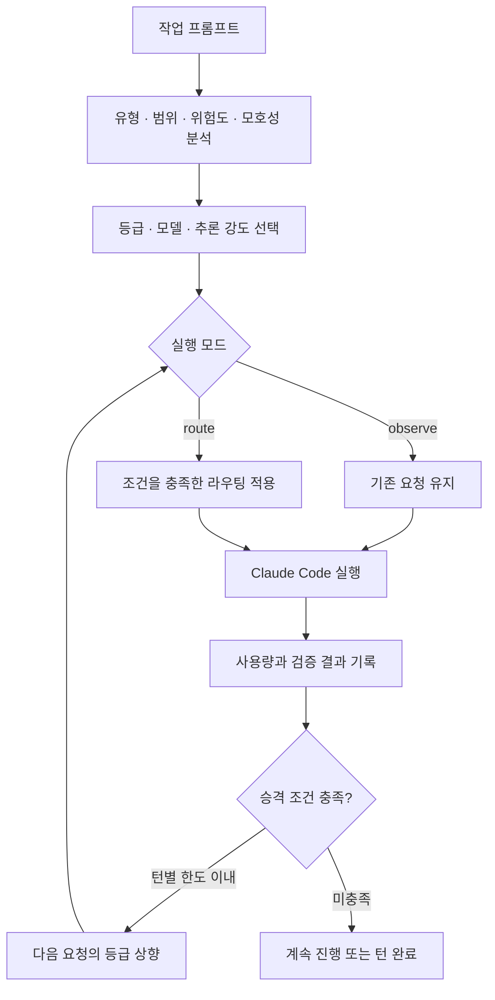

# Agent Fusion Router

**작업에 맞는 모델을 선택하고, 사용량을 로컬에서 확인하는 코딩 에이전트 라우터.**

Agent Fusion Router는 작업을 분석해 모델 등급을 선택하고 실행 결과를 기록합니다. 범위가 명확한 작은 작업은 경량 모델로 처리하고, 일반 작업은 세션 모델을 유지하며, 검증이 반복해서 실패하면 정해진 한도 안에서 상위 등급으로 올립니다. 작업 품질을 유지하면서 완료된 작업의 비용을 측정하고 줄이는 것이 목표입니다.

[English](README.md) · [빠른 시작](#빠른-시작) · [설정](#설정) · [문서](#문서) · [기여하기](#기여하기)

> **0.1.0 · 정식 배포 전 · Claude Code 어댑터 구현**
>
> 기본값은 요청을 변경하지 않는 **관측(`observe`) 모드**입니다. `route` 모드로 설정하면 라우팅을 적용합니다. Codex는 설계 단계입니다. 벤치마크 CLI는 예제 작업을 실행하고, 해시로 검증할 수 있는 증거 파일과 웹 보고서를 만듭니다. 저장소에 예제 작업 6개·조건 3개·반복 1회의 실측 비교가 있지만(아래 "현재 구현 현황" 참고), 반복과 작업 범위가 좁아 일반적인 성공률·비용 절감 결론으로 쓰기는 어렵습니다.

## 프로젝트 소개

코딩 세션에는 코드 위치 찾기, 이름 변경, 기능 구현, 설계 검토처럼 서로 다른 작업이 섞여 있습니다. 모든 요청에 같은 모델을 사용하면 어느 작업을 작은 모델로 처리할 수 있는지 판단하기 어렵습니다. 반대로 모델을 바꾸면서 발생하는 재시도와 문맥 처리 비용까지 고려해야 라우팅의 효과를 평가할 수 있습니다.

Agent Fusion Router는 판단 근거와 사용량을 함께 기록해 이 과정을 확인할 수 있도록 구성했습니다.

- **설명 가능한 분류:** 한국어·영어 규칙으로 작업 유형, 범위, 위험도, 모호성을 분석합니다. 프롬프트 길이만으로 등급을 정하지 않습니다.
- **관측 후 적용:** 기존 세션 모델을 유지하면서 제안된 라우팅과 실제 사용량을 먼저 확인할 수 있습니다.
- **검증 기반 승격:** 인식 가능한 테스트·빌드·린트·타입 검사 명령의 실패를 추적합니다.
- **전환 제어:** 신뢰도 기준, 문맥 크기 보호 장치, 턴별 승격 한도로 모델 전환을 제한합니다.
- **로컬 사용량 보고:** 프롬프트와 소스 코드를 저장하지 않고 토큰 수와 라우팅 근거를 JSON Lines로 기록합니다.

## 현재 구현 현황

| 영역 | 진행 상태 |
| --- | --- |
| 라우팅 코어 | 작업 분석, 3단계 등급, 신뢰도 검사, 캐시 보호, 후속 요청 처리, 승격 구현 |
| Claude Code 어댑터 | 생명주기 훅, 설정, 상태 표시, 명령, 사용량 기록, 서브에이전트 라우팅 구현 |
| 사용량 CLI | `report`(텍스트·JSON·웹 페이지와 캡처), `explain`, `doctor` 구현 |
| 작업 브리프 | 라이브러리 유틸리티 구현. 자동 작업 분해와 어댑터 연결은 예정 |
| 벤치마크 CLI | `bench validate`, `run`, `report`, `verify` 구현. 숨은 검증 테스트가 있는 예제 작업 6개, 웹 보고서, 전체 화면 캡처, SHA-256 증거 파일 |
| Codex 어댑터 | 설계 문서 작성. 실행 기능 미구현 |
| 성능 평가 | **예비 실측 데이터 있음** — 예제 작업 6개 × 조건 3개(Opus 고정/opusplan/자동 라우팅) × 반복 1회: 자동 라우팅이 Opus 고정과 동일하게 6/6 성공하면서 비용은 약 52%($0.378 vs $0.791). 반복 1회·예제 작업 한정이라 일반적인 결론으로 보기엔 근거가 약함 |

**2026-11-01 로컬 검증:** `npm run check` 통과. **단위 테스트 112개**(라우팅 판단·사용량 로그·벤치마크 집계에서 재현된 버그 5개를 수정하며 회귀 테스트 추가), 코어·테스트·CLI 타입 검사, 플러그인 번들 일치 검사를 확인했습니다. 기존 검증 기록에는 Claude Code 2.1.312에서 플러그인 테스트 5개가 통과한 것으로 정리되어 있으며, 이번 문서 갱신에서는 엔진 검사를 재실행하지 않았습니다. 구현 파일과 남은 작업은 [개발 진행 현황](docs/development-status.md)에 정리했습니다.

## 빠른 시작

### 실행 환경

- **Node.js 22.18 이상:** 소스 개발과 TypeScript 테스트 실행에 필요합니다. 빌드된 CLI의 대상 환경은 Node.js 20 이상입니다.
- **npm:** 워크스페이스 의존성 설치와 빌드에 사용합니다.
- **Git:** 벤치마크의 프로젝트 스냅샷 생성에 사용합니다. 선택 기능인 PNG 캡처에는 Chrome·Edge·Chromium이 필요하며, 기본 경로에서 찾지 못하면 `AFR_BROWSER`로 지정합니다.
- **함수형 훅 플러그인 API를 지원하는 Claude Code:** 어댑터 실행에 필요합니다. 저장소에 기록된 환경과 확인 절차는 [호환성 문서](docs/compatibility.md)를 참고하세요.

### 1. 소스에서 빌드

저장소 루트에서 실행합니다.

```bash
npm ci
npm run build
node packages/cli/dist/cli.js explain "README.md 오타 고쳐줘" --model opus
```

`explain`은 로컬 규칙으로 작업 유형, 등급, 신뢰도, 모델 선택, 추론 강도, 판단 근거를 출력합니다. 모델 호출이나 실제 작업 실행은 하지 않습니다. CLI는 현재 저장소에서 빌드해 사용하며, npm 배포는 예정되어 있습니다.

### 2. Claude Code에서 플러그인 로드

저장소에는 빌드된 플러그인이 포함되어 있습니다.

```bash
claude --plugin-dir ./plugins/claude/agent-fusion-router
```

Claude Code 안에서 실행합니다.

```text
/router
/router explain README.md 오타 고쳐줘
```

관측 모드의 상태 표시 예시입니다.

```text
router (observe): light, would use haiku, effort low
```

제안된 라우팅을 확인한 뒤, `/config`에서 플러그인의 **Mode**를 `route`로 바꾸면 결정을 실제 요청에 적용합니다.

### 3. 사용량 확인

```bash
node packages/cli/dist/cli.js report
node packages/cli/dist/cli.js report --since 7d
node packages/cli/dist/cli.js report --since 7d --json
node packages/cli/dist/cli.js doctor
```

공유용 HTML 보고서와 선택적 PNG 캡처를 생성할 수도 있습니다.

```bash
node packages/cli/dist/cli.js report --since 7d --html usage.html
node packages/cli/dist/cli.js report --since 7d --html usage.html --png usage.png
```

### 마켓플레이스 설치

이 저장소는 Claude Code 마켓플레이스로 바로 쓸 수 있습니다. Claude Code 프롬프트에서:

```text
/plugin install agent-fusion-router --marketplace hyebinkimsdf/agentfusionrouter
```

셸에서:

```bash
claude plugin marketplace add hyebinkimsdf/agentfusionrouter
claude plugin install agent-fusion-router@agent-fusion-router
```

마켓플레이스 설치에는 포함된 번들을 사용하므로 별도 로컬 빌드가 필요하지 않습니다. 배포 준비 사항은 [배포 문서](docs/publishing.md)를 참고하세요.

## 동작 방식



| 등급 | 대표 작업 | 기본 모델 | 기본 추론 강도 |
| --- | --- | --- | --- |
| `light` | 명확한 코드 검색, 국소적인 이름 변경, 오타 수정, 기계적 편집 | `haiku` | 적용 가능한 경우 `low` |
| `standard` | 기능 구현, 오류 수정, 분류가 불명확한 작업, 범위가 넓은 기계적 변경 | 세션 모델 유지 | 유지 |
| `heavy` | 설계, 모호하거나 위험도가 높은 작업, 승격된 작업 | `opus` | 적용 가능한 경우 `high` |

메인 루프의 턴 첫 요청에서 결정을 내리고, 승격이 발생할 때까지 같은 결정을 재사용합니다.

1. 경량 작업으로 분류되더라도 신뢰도가 기준에 미달하면 `standard`로 처리합니다.
2. 직전 요청의 문맥 크기가 기본값인 **50,000토큰을 초과**하면 하위 모델 전환을 보류합니다. 현재 모델의 추론 강도는 조정될 수 있습니다.
3. 경량 등급은 세션 모델보다 높은 모델을 선택하지 않고, 고성능 등급은 낮은 모델을 선택하지 않습니다. 모델 계열을 식별할 수 없으면 모델을 유지합니다.
4. 기본값으로 **검증 명령이 연속 2회 실패**하면 **턴당 최대 1회** 등급을 올립니다. 중간에 검증이 성공하면 연속 실패 횟수를 초기화합니다.
5. 이전 시도가 실패했다는 후속 요청은 다음 턴의 등급을 올릴 수 있습니다. 짧은 계속 진행 요청은 이전 등급을 유지하되, 직전 검증이 실패했다면 승격합니다.
6. 서브에이전트는 신뢰도가 충분한 경량 작업만 하위 모델로 시작합니다. 명시한 모델, 재개된 실행, 워크플로 에이전트, 포크는 유지하며 시작 후에는 다시 라우팅하지 않습니다.

`effort` 전략을 선택하면 모델을 유지하고 지원되는 추론 강도만 조정합니다. 구성 요소와 이벤트 흐름은 [아키텍처 문서](docs/architecture.md)에 설명되어 있습니다.

## 설정

`/config`에서 플러그인 설정을 변경합니다. 키와 기본값은 [플러그인 매니페스트](plugins/claude/agent-fusion-router/.claude-plugin/plugin.json)에 정의되어 있습니다.

| 항목 | 설정 키 | 기본값 | 동작 |
| --- | --- | --- | --- |
| 실행 모드 | `mode` | `observe` | 판단만 기록. `route`는 실제 적용 |
| 라우팅 전략 | `strategy` | `model` | 등급별 모델 변경. `effort`는 모델 유지 |
| 경량 모델 | `lightModel` | `haiku` | 조건을 충족한 경량 작업에 사용 |
| 표준 모델 | `standardModel` | 빈 값 | 별도 지정이 없으면 세션 모델 유지 |
| 고성능 모델 | `heavyModel` | `opus` | 고성능 작업과 승격에 사용 |
| 경량 신뢰도 | `minLightConfidence` | `0.5` | 경량 등급 적용의 최소 신뢰도 |
| 캐시 보호 기준 | `cacheGuardTokens` | `50000` | 이 문맥 크기를 초과하면 하위 모델 전환 보류 |
| 승격 전 실패 횟수 | `failuresBeforeEscalation` | `2` | 연속으로 실패한 검증 명령 수 |
| 턴당 승격 한도 | `maxEscalationsPerTurn` | `1` | 한 턴에서 허용하는 등급 상승 횟수 |
| 서브에이전트 라우팅 | `routeSubagents` | `true` | 시작 시 조건에 맞는 모델 선택 적용 |
| 상태 표시 | `showStatus` | `true` | 현재 라우팅 결정 표시 |
| 로그 폴더 | `logDir` | 빈 값 | `~/.agent-fusion-router/logs` 사용 |

각 등급의 모델 설정을 빈 값으로 두면 해당 등급에서 세션 모델을 유지합니다.

## 사용량 보고와 데이터 처리

플러그인은 모델 요청, 턴, 라우팅 검토 대상 서브에이전트 시작을 JSON Lines로 기록합니다. 보고서는 모델별 입력·출력·캐시 읽기·캐시 쓰기 토큰과 등급별·결과별 턴 수를 보여 줍니다.

| 명령 | 용도 |
| --- | --- |
| `/router` | 현재 Claude Code 세션의 라우팅과 사용량 확인 |
| `/router explain <작업>` | 플러그인 설정을 기준으로 작업 분류 설명 |
| `node packages/cli/dist/cli.js report` | 기록된 세션 집계. `--dir`, `--since`, `--json` 지원 |
| `node packages/cli/dist/cli.js report --html usage.html --png usage.png` | 집계를 웹 페이지와 전체 화면 캡처로도 저장 |
| `node packages/cli/dist/cli.js explain "<작업>" --model opus` | 코어 기본 정책의 라우팅 결과를 로컬에서 확인 |
| `node packages/cli/dist/cli.js doctor` | 로그 폴더, 기록 수, 카탈로그 가격 기준일 확인. `--dir` 지원 |

비용은 저장소의 [모델 카탈로그](packages/core/src/catalog.ts)를 기준으로 추정합니다. 라우팅된 요청은 동일한 토큰 수를 원래 요청 모델의 가격으로 환산해 비교할 수도 있습니다. **이 값은 실제 청구 금액이나 실측 절감률이 아닙니다.** 다른 모델은 토큰 수, 재시도 횟수, 작업 결과가 달라질 수 있습니다. 가격을 알 수 없는 모델은 비용 합계에서 제외하고 보고서에 표시합니다.

라우터 자체는 네트워크 요청을 보내지 않습니다. Claude Code의 모델 요청은 기존에 설정된 제공자로 전송됩니다. 라우터 로그에는 식별자, 판단 태그, 토큰 수, 시간, 검증 횟수를 기록하며 프롬프트·코드·파일 내용·도구 입출력·모델 응답은 저장하지 않습니다. 기록 구조와 삭제 방법은 [데이터 처리 문서](docs/data-handling.md)를 참고하세요.

## 평가 방법

동일한 시작 프로젝트에서 **고성능 모델 고정**, **표준 모델 고정**, **자동 라우팅**을 비교합니다. 작업 성공률, 성공한 작업당 총비용, 소요 시간, 사람이 수정한 양, 승격 횟수를 함께 평가합니다.

[쇼핑 예제 작업 모음](examples/shop/tasks.json)에는 코드 위치 찾기, 오타 수정, 프로젝트 전체 이름 변경, 기능 추가, 버그 수정, 세금 규칙 설계 등 6개 작업이 있습니다. 각 작업의 성공 여부는 에이전트가 볼 수 없는 숨은 테스트로 판정하며, 에이전트가 끝난 뒤 벤치마크가 직접 실행합니다.

```bash
node packages/cli/dist/cli.js bench validate             # 검증이 풀이 전에는 실패하고 기준 해답으로는 통과하는지 확인
node packages/cli/dist/cli.js bench run --simulate --no-png  # 모델 호출 없이 전체 흐름 점검
node packages/cli/dist/cli.js bench run --reps 3 --budget 1 --timeout 15 --no-png  # 실제 모델 호출
```

`bench run`이 출력한 실행 폴더 경로로 `<run-folder>`를 바꿔 검증하거나 보고서를 다시 생성합니다.

```bash
node packages/cli/dist/cli.js bench verify "<run-folder>"
node packages/cli/dist/cli.js bench report "<run-folder>" --no-png
```

실제 실행은 작업·조건·반복마다 프로젝트를 새로 복사해 `claude -p`를 호출합니다. `--budget`은 실험 전체가 아닌 **개별 실행마다** Claude Code에 전달하는 예산입니다. 작업 6개·조건 3개를 3회씩 반복하면 **총 54회** 실행합니다. [기본 자동 라우팅 조건](benchmarks/arms.json)은 `standardModel: "sonnet"`을 지정하며, 일반 플러그인의 기본값은 세션 모델 유지입니다.

실행 폴더에는 원본 기록, 웹 보고서(`report.html`), `evidence.sha256`이 남습니다. `--no-png`를 생략하면 설치된 브라우저로 전체 페이지 캡처(`report.png`)도 시도합니다. 보고서와 캡처에는 증거 파일 목록의 해시가 표시되며, `bench verify`는 원본 기록에서 개별 결과와 집계를 다시 계산합니다.

시뮬레이션의 사용량과 시간은 흐름 점검용 가상 값이며 모델 품질이나 비용 절감 효과를 입증하지 않습니다. 보고서에도 그렇게 표시됩니다. 실제 모델 비교 결과는 아직 포함되어 있지 않습니다. [벤치마크 절차](benchmarks/README.md)를 참고하세요.

2026-10-30에 기존 로컬 **시뮬레이션 18회분**의 증거 검증을 확인했으며, 상세 내역은 [개발 진행 현황](docs/development-status.md)에 기록했습니다. 벤치마크 증거 파일에는 작업 프롬프트, 모델 출력, 코드 변경 내역, 검증 출력, 설정을 보관합니다. 일반 플러그인 사용량 로그보다 기록 범위가 넓으므로 공유 전에 내용을 확인하세요.

## 저장소 구조

```text
agentfusionrouter/
├── packages/
│   ├── core/                 작업 분석, 라우팅, 승격, 브리프, 사용량 집계
│   ├── claude-adapter/       Claude Code 훅, 설정, 로그
│   ├── cli/                  사용량·벤치마크 CLI, 웹 보고서, 캡처
│   └── codex-adapter/        실행기 설계 문서
├── plugins/claude/agent-fusion-router/
│                             설치용 번들, 매니페스트, 통합 테스트
├── .claude-plugin/           마켓플레이스 매니페스트
├── .github/workflows/        CI 설정
├── examples/shop/            예제 프로젝트, 작업 정의, 검증 코드, 기준 해답
├── benchmarks/               평가 절차, 비교 조건, 실행 폴더
├── docs/                     아키텍처, 호환성, 데이터, 진행 현황, 배포
└── scripts/                  빌드와 Claude Code 타입 동기화
```

## 개발 및 검증

```bash
npm ci
npm run typecheck
npm test
npm run build
npm run check
```

`npm run check`는 코어·테스트·CLI 타입 검사, 단위 테스트, 플러그인 번들과 소스의 일치 검사를 수행합니다. CLI를 다시 빌드하지는 않습니다. [CI 설정](.github/workflows/ci.yml)에서는 Node.js 24로 이 검사를 실행합니다.

어댑터 타입 검사에는 Claude Code API 선언 파일이 필요합니다. `--plugin-dir`로 플러그인을 한 번 로드하거나 `CLAUDE_CODE_TYPES`에 선언 파일 경로를 지정한 뒤 실행합니다.

```bash
npm run typecheck:claude
claude plugin validate plugins/claude/agent-fusion-router
claude plugin test plugins/claude/agent-fusion-router
```

플러그인 통합 테스트 5개는 코어 단위 테스트와 별도로 정의되어 있습니다. 코어 또는 어댑터 소스를 수정하면 다시 빌드하고 `plugins/claude/agent-fusion-router/hooks/register.js`를 변경에 함께 포함하세요. 생성된 번들 대신 원본 소스를 수정합니다.

## 기여하기

변경하려는 문제, 변경 후 동작, 관련 검증 결과를 함께 설명해 주세요. 라우팅 규칙을 수정할 때는 의도한 분류와 영향을 받는 주변 사례를 테스트에 포함합니다. 플러그인 샌드박스에서 실행할 수 있도록 `packages/core`에는 Node 및 DOM API 의존성을 추가하지 않습니다.

풀 리퀘스트 전에 해당 변경에 필요한 검사를 실행하고, 관련 문서와 사용자에게 보이는 변경 사항을 [변경 이력](CHANGELOG.md)에 반영해 주세요. 성능 개선을 제시할 때는 재현 가능한 작업과 원시 기록을 포함하고, 시뮬레이션 결과와 실제 실행 결과를 명확히 표시합니다.

## 로드맵

- [x] 관측 모드, 작업 분류, 로컬 사용량 기록
- [x] 선택적으로 활성화하는 모델 라우팅, 추론 강도 전략, 신뢰도·캐시 보호
- [x] 한도가 있는 검증 기반 승격과 서브에이전트 라우팅
- [x] 사용량 CLI, 단위 테스트, 플러그인 통합 테스트 정의, CI 설정
- [x] 작업 브리프 유틸리티와 벤치마크 예제·보조 모듈
- [x] 벤치마크 실행기, CLI 명령, 보고서 생성 연결
- [ ] 원시 기록을 포함한 반복 실측 비교 공개
- [ ] 자동 작업 분해와 실행 어댑터 연결
- [ ] 설계 문서에 따른 Codex 실행기 구현
- [ ] 모호한 분류에 대한 소형 모델 보조 판단 검토

## 문서

| 문서 | 내용 |
| --- | --- |
| [개발 진행 현황](docs/development-status.md) | 구현 내역, 검증 결과, 남은 연결 작업 |
| [아키텍처](docs/architecture.md) | 코어 구성 요소, 어댑터 이벤트, 플러그인 제약 |
| [호환성](docs/compatibility.md) | 실행 환경과 저장소에 기록된 호스트 버전 |
| [데이터 처리](docs/data-handling.md) | 로그 필드, 접근 범위, 데이터 보관 |
| [벤치마크 절차](benchmarks/README.md) | 비교 조건, 작업 검증, 평가 지표 |
| [배포](docs/publishing.md) | 마켓플레이스와 릴리스 준비 |
| [Codex 설계](packages/codex-adapter/README.md) | 향후 어댑터의 범위 |
| [변경 이력](CHANGELOG.md) | 버전별 변경 사항 |

## 라이선스

[MIT License](LICENSE)로 배포합니다. Copyright © 2026 hyebinkimsdf.
