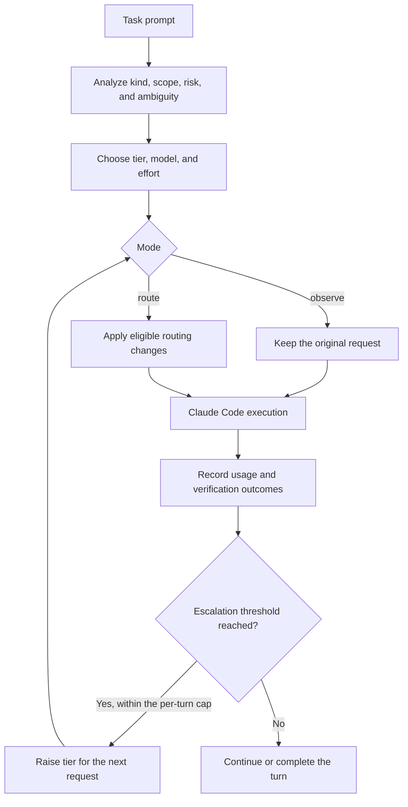

# Agent Fusion Router

**Task-aware model routing and local usage reports for coding agents.**

Agent Fusion Router classifies a task, selects a model tier, and tracks the result. Clear, small tasks can use a lighter model; ordinary work keeps the session model; repeated verification failures trigger a capped escalation. The goal is to measure and reduce the cost of completed work while preserving task quality.

[한국어](README.ko.md) · [Quick start](#quick-start) · [Configuration](#configuration) · [Documentation](#documentation) · [Contributing](#contributing)

> **0.1.0 · Unreleased · Claude Code adapter implemented**
>
> The plugin starts in **observe mode** and changes no requests until you enable `route`. Codex support is planned. The benchmark CLI runs sample tasks and produces a web report with hash-verified evidence. The repository holds one preliminary live comparison (six sample tasks, three arms, one repetition each — see "Project status" below); the sample is too small to support a general success-rate or cost-savings claim.

## Why Agent Fusion Router?

Coding sessions mix lookups, mechanical edits, feature work, and design decisions. Applying the same model to every request makes it difficult to understand where a smaller model would be sufficient. Routing also has a cost: failed attempts and model changes can offset any savings.

This project makes routing decisions explicit and records the usage needed to evaluate them:

- **Rules you can inspect.** English and Korean signals identify task kind, scope, risk, and ambiguity. Prompt length alone does not determine the tier.
- **Observe before applying.** Review proposed decisions and actual usage before enabling routing.
- **Verification-driven escalation.** Recognized test, build, lint, and typecheck failures can move a turn up a tier.
- **Controlled model changes.** Confidence thresholds, a context-size guard, and escalation limits constrain routing.
- **Local reporting.** JSON Lines records capture token counts and decision tags without storing prompt text or source code.

## Project status

| Area | Current state |
| --- | --- |
| Routing core | Implemented: analysis, three tiers, confidence checks, cache guard, follow-ups, escalation |
| Claude Code adapter | Implemented: lifecycle hooks, settings, status line, commands, usage logging, subagent routing |
| Usage CLI | Implemented: `report` (text, JSON, or web page with screenshot), `explain`, `doctor` |
| Task briefs | Library utilities implemented; automatic task splitting is not connected to the adapter |
| Benchmark CLI | Implemented: `bench validate`, `run`, `report`, `verify`; six sample tasks with hidden checks; web report, full-page screenshot, SHA-256 evidence |
| Codex adapter | Design notes only |
| Performance results | **One preliminary live run** — six sample tasks × three arms (Opus-fixed / opusplan / auto-route) × one repetition: auto-route matched Opus-fixed's 6/6 success at about 52% of its cost ($0.378 vs $0.791). One repetition on the sample tasks alone is a thin basis for a general claim |

The [development status](docs/development-status.md) records the implementation inventory, verification results, and remaining work. Local verification on **2026-11-01** passed `npm run check`: **112 tests** (added regression tests while fixing 5 reproducible bugs in routing decisions, usage logging, and benchmark aggregation), core/test/CLI typechecks, and plugin bundle consistency. Existing verification notes record 5 plugin tests passing on Claude Code 2.1.312; those engine checks were not rerun during this documentation update.

## Quick start

### Requirements

- **Node.js 22.18+** for development and TypeScript tests. The built CLI targets Node.js 20+.
- **npm** to install workspace dependencies and build from source.
- **Git** for benchmark project snapshots. Optional PNG capture requires Chrome, Edge, or Chromium; set `AFR_BROWSER` when the browser is not in a standard location.
- **Claude Code with the function-hook plugin API** to run the adapter. See [compatibility](docs/compatibility.md) for the repository's recorded environment and checks.

### 1. Build from source

From the repository root:

```bash
npm ci
npm run build
node packages/cli/dist/cli.js explain "rename getUser to fetchUser in src/api/user.ts" --model opus
```

`explain` runs the local rules and prints the task kind, tier, confidence, model decision, effort, and reason tags. It does not call a model or execute the task. The CLI is currently used from this repository; an npm release is pending.

### 2. Load the Claude Code plugin

The repository includes a bundled plugin:

```bash
claude --plugin-dir ./plugins/claude/agent-fusion-router
```

Inside Claude Code:

```text
/router
/router explain rename getUser to fetchUser in src/api/user.ts
```

An observe-mode status can look like:

```text
router (observe): light, would use haiku, effort low
```

Review the proposed routing, then set the plugin's **Mode** to `route` in `/config` to apply decisions.

### 3. Inspect recorded usage

```bash
node packages/cli/dist/cli.js report
node packages/cli/dist/cli.js report --since 7d
node packages/cli/dist/cli.js report --since 7d --json
node packages/cli/dist/cli.js doctor
```

Export a shareable report, optionally with a PNG capture:

```bash
node packages/cli/dist/cli.js report --since 7d --html usage.html
node packages/cli/dist/cli.js report --since 7d --html usage.html --png usage.png
```

### Marketplace installation

The repository is a Claude Code marketplace. At the Claude Code prompt:

```text
/plugin install agent-fusion-router --marketplace hyebinkimsdf/agentfusionrouter
```

Or from a shell:

```bash
claude plugin marketplace add hyebinkimsdf/agentfusionrouter
claude plugin install agent-fusion-router@agent-fusion-router
```

Marketplace installation uses the bundled plugin and does not require a local build. See [publishing](docs/publishing.md) for release preparation.

## How routing works



| Tier | Typical work | Default model | Default effort |
| --- | --- | --- | --- |
| `light` | Clear lookups, local renames, typos, mechanical edits | `haiku` | `low`, when applicable |
| `standard` | Features, bug fixes, unclear classifications, wider mechanical changes | Session model | Unchanged |
| `heavy` | Design, ambiguity, high-risk work, escalated tasks | `opus` | `high`, when applicable |

The router decides at the first request of a main-loop turn and reuses that decision until an escalation. Its main constraints are:

1. A light classification below the confidence threshold stays at `standard`.
2. A downgrade is held when the last known context exceeds **50,000 tokens** by default. Effort may still change on the current model.
3. The light tier never upgrades the session model; the heavy tier never downgrades it. Models whose family cannot be identified are kept.
4. **Two consecutive failed verification commands** trigger an escalation, capped at **one per turn** by default. A successful check resets the consecutive-failure count.
5. Failure follow-ups can raise the next turn's tier. Short continuations retain the previous tier unless the previous verification failed.
6. Subagent routing selects a lighter model only for confident light tasks. Explicit model choices, resumed agents, workflow agents, and forks are preserved. Subagents are not rerouted after starting.

The `effort` strategy keeps the model and adjusts only reasoning effort where supported. See the [architecture guide](docs/architecture.md) for implementation details.

## Configuration

Configure the plugin through `/config`. Keys and defaults are defined in the [plugin manifest](plugins/claude/agent-fusion-router/.claude-plugin/plugin.json).

| Setting | Key | Default | Behavior |
| --- | --- | --- | --- |
| Mode | `mode` | `observe` | Record proposed decisions; use `route` to apply them |
| Strategy | `strategy` | `model` | Switch models by tier, or use `effort` to retain the model |
| Light tier model | `lightModel` | `haiku` | Model for eligible light tasks |
| Standard tier model | `standardModel` | Empty | Keep the session model unless configured |
| Heavy tier model | `heavyModel` | `opus` | Model for heavy work and escalations |
| Light tier confidence | `minLightConfidence` | `0.5` | Minimum confidence for the light tier |
| Cache guard | `cacheGuardTokens` | `50000` | Hold model downgrades above this context size |
| Failures before escalation | `failuresBeforeEscalation` | `2` | Consecutive failed verification commands |
| Escalations per turn | `maxEscalationsPerTurn` | `1` | Maximum tier increases within a turn |
| Route subagents | `routeSubagents` | `true` | Apply eligible model selection when subagents start |
| Show status | `showStatus` | `true` | Display the current routing decision |
| Log folder | `logDir` | Empty | Use `~/.agent-fusion-router/logs` |

An empty tier-model setting keeps the session model for that tier.

## Usage reports and data handling

The plugin records model requests, turns, and eligible subagent starts as JSON Lines. Reports group input, output, cache-read, and cache-write tokens by model, with routing tiers and turn outcomes.

| Command | Purpose |
| --- | --- |
| `/router` | Show routing and usage for the current Claude Code session |
| `/router explain <task>` | Explain a task classification using the plugin's configuration |
| `node packages/cli/dist/cli.js report` | Summarize recorded sessions; accepts `--dir`, `--since`, and `--json` |
| `node packages/cli/dist/cli.js report --html usage.html --png usage.png` | Also write the summary as a web page and a full-page screenshot |
| `node packages/cli/dist/cli.js explain "<task>" --model opus` | Preview the core's default routing policy locally |
| `node packages/cli/dist/cli.js doctor` | Inspect the log folder, record counts, and catalog price date; accepts `--dir` |

Cost estimates use the versioned [model catalog](packages/core/src/catalog.ts). A routed request can also be priced at its originally requested model using the same token counts. **This is an estimate, not an invoice or a measured savings result:** a different model could produce different tokens, retries, and outcomes. Unknown prices are excluded from cost totals and identified in the report.

The router makes no network requests of its own. Claude Code continues to send model requests to its configured provider. Router logs contain identifiers, decision tags, token counts, timings, and verification counts; they exclude prompt text, code, file contents, tool payloads, and model responses. See [data handling](docs/data-handling.md) for the record schema and deletion instructions.

## Evaluation

The benchmark protocol compares **heavy fixed**, **standard fixed**, and **auto-routed** runs from the same starting project. Primary measures are task success, total cost per successful task, elapsed time, human corrections, and escalations.

The [shop task set](examples/shop/tasks.json) contains six tasks covering lookup, typo correction, project-wide renaming, feature work, debugging, and tax-rule design. Each task is judged by hidden tests the agent never sees, run by the benchmark after the agent finishes.

```bash
node packages/cli/dist/cli.js bench validate             # each check fails before and passes with the reference solution
node packages/cli/dist/cli.js bench run --simulate --no-png  # the whole pipeline, no model called
node packages/cli/dist/cli.js bench run --reps 3 --budget 1 --timeout 15 --no-png  # live model calls
```

Replace `<run-folder>` with the path printed by `bench run`:

```bash
node packages/cli/dist/cli.js bench verify "<run-folder>"
node packages/cli/dist/cli.js bench report "<run-folder>" --no-png
```

A live run calls `claude -p` once per task, arm, and repetition in a fresh copy of the project. `--budget` is passed to Claude Code **per run**, not as an experiment-wide budget: six tasks and three arms at three repetitions produce **54 runs**. The default [auto arm](benchmarks/arms.json) sets `standardModel: "sonnet"`; the plugin's normal default keeps the session model.

Each run folder contains raw evidence, a web report (`report.html`), and `evidence.sha256`. Omit `--no-png` to attempt a full-page screenshot (`report.png`) with an installed browser. The report and screenshot display the hash of the evidence list, and `bench verify` recomputes each result and summary from the raw files.

Simulation uses invented usage and timing values to exercise the workflow; it cannot establish model quality or cost savings, and its reports say so. No live benchmark results are included yet. See the [protocol](benchmarks/README.md).

An existing local **18-run simulation** passed evidence verification on 2026-10-30; its details are recorded in the [development status](docs/development-status.md). Benchmark evidence includes task prompts, model output, code diffs, check output, and settings. This is broader than plugin usage logging; review those files before sharing them.

## Repository structure

```text
agentfusionrouter/
├── packages/
│   ├── core/                 Analysis, routing, escalation, briefs, accounting
│   ├── claude-adapter/       Claude Code hooks, configuration, logging
│   ├── cli/                  Usage and benchmark CLI, web reports, screenshots
│   └── codex-adapter/        Proposed runner design
├── plugins/claude/agent-fusion-router/
│                             Installable bundle, manifest, integration tests
├── .claude-plugin/           Marketplace manifest
├── .github/workflows/        CI configuration
├── examples/shop/            Sample project, tasks, checks, reference solutions
├── benchmarks/               Protocol, comparison arms, run folders
├── docs/                     Architecture, compatibility, data, status, publishing
└── scripts/                  Build and Claude Code type synchronization
```

## Development

```bash
npm ci
npm run typecheck
npm test
npm run build
npm run check
```

`npm run check` runs core/test/CLI typechecks, the unit suite, and a check that the plugin bundle matches its source. It does not rebuild the CLI. [CI](.github/workflows/ci.yml) runs this check on Node.js 24.

The adapter's typecheck requires Claude Code API declarations. Load the plugin once with `--plugin-dir`, or set `CLAUDE_CODE_TYPES` to a declaration file, then run:

```bash
npm run typecheck:claude
claude plugin validate plugins/claude/agent-fusion-router
claude plugin test plugins/claude/agent-fusion-router
```

Five plugin integration tests are defined separately from the core suite. After changing core or adapter source, rebuild and include `plugins/claude/agent-fusion-router/hooks/register.js` in the change. Edit source files rather than the generated bundle.

## Contributing

Changes should include a clear problem statement, the resulting behavior, and relevant verification. For routing rules, add cases that show the intended classification and protect neighboring cases. Keep `packages/core` free of Node and DOM APIs so it can run inside the plugin sandbox.

Before opening a pull request, run the applicable checks above, update affected documentation, and record user-visible changes in the [changelog](CHANGELOG.md). For performance claims, include reproducible tasks and raw evidence, with simulated and live results clearly identified.

## Roadmap

- [x] Observe mode, task classification, and local usage records
- [x] Opt-in model routing, effort strategy, and confidence/cache guards
- [x] Capped verification escalation and eligible subagent routing
- [x] Usage CLI, unit tests, plugin test definitions, and CI configuration
- [x] Task-brief utilities and benchmark fixtures/support modules
- [x] Connect the benchmark runner, CLI commands, and report generation
- [ ] Publish repeated live comparisons with raw evidence
- [ ] Connect automatic task splitting to an execution adapter
- [ ] Implement the Codex runner described in the design notes
- [ ] Evaluate a small-model fallback for ambiguous classifications

## Documentation

| Document | Contents |
| --- | --- |
| [Development status](docs/development-status.md) | Implemented work, verification snapshot, and remaining integration (한국어) |
| [Architecture](docs/architecture.md) | Core components, adapter events, and plugin constraints |
| [Compatibility](docs/compatibility.md) | Runtime requirements and recorded host versions |
| [Data handling](docs/data-handling.md) | Log fields, access scope, and retention |
| [Benchmark protocol](benchmarks/README.md) | Comparison arms, task checks, and metrics |
| [Publishing](docs/publishing.md) | Marketplace and release preparation |
| [Codex design](packages/codex-adapter/README.md) | Planned adapter scope |
| [Changelog](CHANGELOG.md) | Version history |

## License

Licensed under the [MIT License](LICENSE). Copyright © 2026 hyebinkimsdf.
